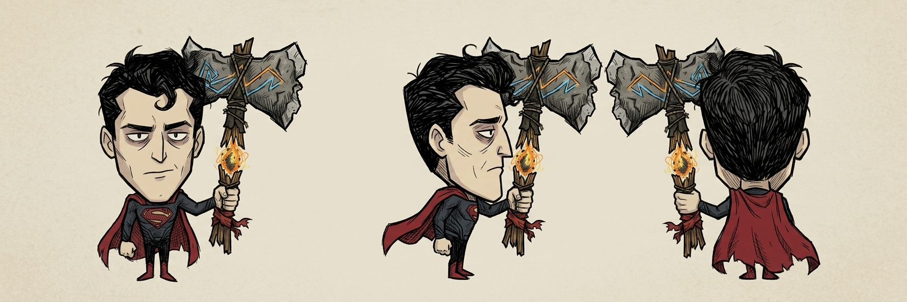

# Krypton Survivor · 氪星幸存者

简体中文 · [English](README.en.md)

将 DC 超人带入 Steam《饥荒联机版》。高属性、完整夜视、热视线、冰冻吐息、飞行、地图瞬移与黑暗形态，搭配专属战斧**拉奥之锋**与**星核护符**，适合与朋友轻松探索和战斗。

**当前版本：0.11.0，已发布至 Steam 创意工坊。** 支持中文和英语；完整改动见[更新记录](docs/changelog.md)。

[Steam 创意工坊](https://steamcommunity.com/sharedfiles/filedetails/?id=3811663817) · [更新记录](docs/changelog.md) · [开发说明](docs/build.md) · [反馈问题](https://github.com/JerAxxxxxxx/DST-KryptonSurvivor/issues)



## 安装与操作

1. 在 Steam 创意工坊订阅本 Mod。
2. 创建或编辑世界，在**服务器模组**中启用本 Mod。
3. 进入选人界面，选择**超人**。

联机玩家需使用相同版本。更新下载完成后重启游戏，避免同时启用工坊版与本地同名版本。手动安装时，将仓库的 `mod/` 目录完整复制到游戏的 `mods/KryptonSurvivor/`。

| 操作 | 默认方式 |
| --- | --- |
| 热视线 | 鼠标瞄准方向，按 **R** 发射 |
| 冰冻吐息 | 鼠标瞄准方向，按 **X** 喷出冷气 |
| 切换飞行 | 按 **V**；出生默认开启 |
| 黑暗形态 | 按 **H** 切换正常／黑暗超人，无需装备 |
| 地图瞬移 | 打开地图（默认 **Tab**），按住 **Ctrl**，右键点击落点 |
| 持斧采集 | **空格或左键**采浆果、草和树枝 |
| 持斧挖掘 | **右键**挖植物；树桩也可用空格挖掉 |

热视线、冰冻吐息、飞行和瞬移都是人物自带能力，无需装备。地图瞬移会自动关闭地图，在游戏恢复后执行；成功或失败均有提示。

## 人物能力

- 生命、饥饿、理智上限各 **10000**。
- 无自然饥饿和持续理智消耗；正常形态中，食物等即时效果仍可能影响理智。
- 完整夜视，夜晚和洞穴中均可看清环境，无鼹鼠视野滤镜。
- 地表白天默认每秒恢复 **100 生命**；正常形态同时恢复 **100 理智**。两种恢复可分别设为 **0、10、50、100 或 500／秒**，0关闭；黑暗形态始终维持低理智。黄昏、夜晚、洞穴及死亡或幽灵状态不触发白天恢复。
- 移动速度为普通角色的 **1.5、2 或 3 倍**，默认 **1.5 倍**。
- 吃东西时有张嘴、咀嚼与满足表情，保留原版身体、食物和声音；结束或被打断后恢复常态。

## 黑暗超人形态

按 **H** 在正常与黑暗形态之间切换，可在本机配置中改为 J、K 或关闭按键；没有材料或装备要求。

- 黑暗形态将真实理智维持在约 **5%**（上限10000时约500），停止白天自动回理智。食物、击败暗影等引起变化后，服务器会在下个模拟时刻校正。
- 切回正常时恢复进入前的理智比例，遵循当前原生理智惩罚；白天自动回理智恢复。切换不改变生命值、回血、夜视或其他超能力。
- 形态随角色存档、跨洞穴迁移及复活保留；幽灵和死亡期间不强制修改理智。
- 低理智满足普通疯狂条件，暗影生物仍按原版刷新及交互规则出现，不会立即凭空召唤。月岛等启蒙区域沿用原版启蒙机制，低理智不保证出现普通暗影怪物；其他强制理智效果也保留。
- 聊天、界面、暂停、忙碌或死亡时不能切换；安全骑乘和飞行中可以切换。H与R使用一致的按键规则，Ctrl／Alt／Shift不会单独禁用能力。面板显示当前形态和实际按键，切换有文字提示。第一版沿用已有外观。

## 热视线

- 射程 **20**，沿直线穿透多个敌人，并可点燃仍存活的可燃、非火焰免疫生物。
- 伤害可设为 **2000、10000 或 50000**，默认 **2000**，与战斧独立配置。
- 无资源消耗，最短发射间隔 **0.35 秒**；光束从眼睛向前发射，跟随头部动作。
- 直接命中跳过玩家、随从、伙伴、驯化生物、墙和建筑；点燃后的原版火焰仍可能蔓延。
- 服务器可关闭“热视线点燃目标”，保留光束伤害与视觉效果；默认开启。

聊天、界面操作、建筑放置、忙碌、工作、死亡、幽灵及服务器暂停期间无法发射。

## 冰冻吐息

鼠标瞄准方向，按 **X** 从嘴部喷出蓝白色冷气与冰晶；无需独立装备，也不消耗饥饿、理智、材料或耐久。

- 前方扇形范围 **8**，半角 **28°**；每次持续约 **1 秒**，最短使用间隔 **1.2 秒**。
- 对范围内的敌人施加原版冻结效果，每次吐息对同一目标最多施加一次冷量，服务器可选 **1、2、4 或 8**，默认 **2**，不造成直接生命伤害。
- 是否冻结与实际控制时间遵循原版生物抗性、免冻状态和 Boss 冻结递减，不保证所有目标立刻冻结或统一冻住几秒。
- 冻结会跳过玩家、随从、伙伴、驯化生物、墙和建筑；仍可扑灭范围内队友、建筑与树木身上的火焰或阴燃。
- 营火、烹饪设施及使用燃料的设备会保留，避免误熄正在工作的火源。
- 服务器可关闭能力；每位玩家可选择 **X、C、N** 或关闭按键。聊天、界面操作、建筑放置、忙碌、骑乘、死亡或暂停等状态下无法使用。

释放时切换到原图提供的张嘴表情，冷气随嘴部位置移动；正面与侧面使用各自的头部，背面保留原有后脑。吐息结束或被动作打断后恢复常态，身体与装备继续沿用游戏动作。

## 拉奥之锋

- 开局自带并自动装备，仅超人可以使用；无限耐久。
- 伤害可设为 **2000、10000 或 50000**，默认 **2000**。
- 近战攻击距离可选 **3、6、10、16**，默认 **6**；范围伤害半径可选 **0、3、5、8、12**，默认 **5**，0关闭范围伤害并保留主目标攻击。范围攻击与热视线、吐息冻结共用保护规则，跳过玩家、随从、伙伴、驯化及玩家友方生物、墙和建筑。主动普攻主目标沿用原版规则。
- 集攻击、砍树、挖矿、锤砸和挖掘于一体，工作效率为普通工具的 **10 倍**。
- 空格和左键优先采集，采完不会挖掉植物；右键可挖草丛、树苗和浆果丛。挖地皮仍需草叉。
- 装备后在夜晚和洞穴提供照明，也能帮助附近的朋友；攻击、采集和照明不消耗燃料。

## 星核护符

仅超人可装备，使用**身体装备栏，与背包和防具共用**；无限耐久，无持续资源消耗。

- **获取**：新角色开局自带并装备。旧存档首次升级补发一次，身体栏已有装备时放入物品栏，满包则掉在身边；丢失或重进不会重复补发。
- **环境保护**：装备后潮湿归零并保持干燥，体温保持安全范围（默认 **10～50°C**），免疫寒冷和过热伤害，并避免相应提示；卸下后恢复正常温度变化。
- **自动复活**：装备且能力就绪时，死亡后在原位置复活，生命恢复到当前上限。护符保留，其他物品沿用原版掉落规则。
- **冷却**：成功复活后冷却**一个游戏日**，默认 **480 秒模拟时间**。冷却随人物保存，换护符或重新制作无法重置；期间干燥和温度保护仍有效。
- **制作**：人物制作分类，徒手制作，无需工作站；材料为**金块 ×3、噩梦燃料 ×2、红宝石 ×1**。

检查冷却中的护符会提示正在恢复，冷却结束且佩戴时提示已就绪。火焰、战斗伤害、食物的生命／饥饿／理智效果与冻结控制不属于护符免疫范围。自动复活沿用幽灵或可复活尸体机制；荒野模式保留原有死亡重选规则。

## 飞行与地图瞬移

两项能力均无需装备，不消耗饥饿、理智、材料或耐久。地图瞬移没有距离限制。

- **飞行**可跨海面和洞穴内部断层，墙、树等普通障碍仍有碰撞。需要回到安全陆地或船上才能关闭；海面或洞穴空洞上无法着陆。骑乘时暂停飞行，切换前需下坐骑。
- **瞬移**只在当前世界分片内移动，地表与洞穴之间仍通过入口切换。飞行开启时可选海面，关闭时只允许安全陆地或船上。
- 地图外、洞穴空洞、被建筑或洞口占据的落点及原生特殊屏障会拒绝瞬移；忙碌、骑乘、死亡、幽灵或服务器暂停时无法使用。
- 飞行移动播放轻微风声，悬停时安静；着陆和骑乘恢复正常脚步声。
- 飞行循环暂不显示手持物品和帽子；攻击、采集、热视线和冰冻吐息恢复普通人物动作与装备显示，装备属性仍生效。

## 能力状态面板

默认显示在**屏幕右上角，生命／饥饿／理智与湿度表下方**，仅超人显示。上方保留三行状态：

- **飞行**：蓝色表示开启；关闭、骑乘暂停或当前不可用时显示灰色。
- **护符**：绿色表示干燥与安全体温保护生效；未装备或当前未生效时显示灰色。
- **复活**：绿色表示已就绪；冷却时显示如 `04:35` 的倒计时。未佩戴护符时不会误显示“已就绪”。

复活冷却期间，护符的干燥与温度保护仍可生效；卸下护符后冷却也会继续。状态与倒计时由服务器每个模拟秒同步，暂停时不会继续倒数。鼠标悬停可查看说明。

三行分别配有红披风、星核盾牌和复活箭头图标，不可用时变暗；状态文字与倒计时保持显示。每位玩家可在自己的 Mod 配置中隐藏面板、调整为 **80%／100%／120%**，或在**默认、向左移、向下移**三个位置间切换。

下方增加**热视线与冰冻吐息**两行，显示每位玩家实际设置的按键与就绪、冷却、施放或暂不可用状态。短冷却使用变暗提示，不滚动显示小数；关闭按键或服务器关闭吐息时也有对应说明。技能状态来自服务器，冷却结束通过模拟时间更新，暂停不会按现实时间倒数。面板只读，可悬停查看说明。

最下方的**形态**行显示正常或黑暗超人，黑暗时为紫色；它读取服务器同步的形态，不会在暂停时预测切换。

## 配置

| 配置 | 可选值 | 默认值 |
| --- | --- | --- |
| 语言 | 自动、中文、英语 | 自动 |
| 移动速度 | 1.5、2、3 倍 | 1.5 倍 |
| 战斧伤害 | 2000、10000、50000 | 2000 |
| 战斧攻击距离（服务器） | 3、6、10、16 | 6 |
| 战斧范围伤害半径（服务器） | 0关闭、3、5、8、12 | 5 |
| 吐息冷量（服务器） | 1、2、4、8 | 2 |
| 白天回血／秒（服务器） | 0关闭、10、50、100、500 | 100 |
| 白天回理智／秒（服务器） | 0关闭、10、50、100、500 | 100 |
| 热视线伤害 | 2000、10000、50000 | 2000 |
| 热视线点燃目标（服务器） | 开启、关闭 | 开启 |
| 热视线按键 | R、G、Z、关闭 | R |
| 冰冻吐息能力（服务器） | 开启、关闭 | 开启 |
| 冰冻吐息按键 | X、C、N、关闭按键 | X |
| 飞行能力（服务器） | 开启、关闭 | 开启 |
| 飞行切换按键 | V、B、关闭按键 | V |
| 黑暗形态按键 | H、J、K、关闭按键 | H |
| 地图瞬移能力（服务器） | 开启、关闭 | 开启 |
| 地图瞬移操作 | Ctrl＋右键、关闭操作 | Ctrl＋右键 |
| 能力状态面板 | 显示、隐藏 | 显示 |
| 能力面板大小 | 80%、100%、120% | 100% |
| 能力面板位置 | 默认、向左移、向下移 | 默认 |

共 **21 项配置**。新增数值由房主在**创建／编辑世界 → 服务器模组 → 配置**中设置，重开世界后生效，所有玩家使用同一服务器规则；旧世界缺少新字段时沿用默认值。热视线／冰冻吐息／飞行／黑暗形态按键、地图瞬移操作，以及面板显示、大小和位置，由每位玩家在自己的 Mod 配置中设置；瞬移快捷操作当前面向键鼠，原手柄地图操作保留。星核护符复活冷却固定为一个游戏日。

## 开发

使用 **Node.js 24** 检查 Lua 和资源引用：

```shell
npm ci
npm run check
```

发布前资源检查另需 Python 3.13，安装 `requirements-check.txt` 中的最小依赖后运行 `npm run check:assets`。它检查自有动画、图集、纹理和头部帧覆盖，并验证缺帧／缺文件等损坏能被拒绝；无需安装游戏或重建美术。GitHub Actions 已配置相同流程，随代码推送后执行。

`mod/` 包含可直接安装的脚本与编译资源，`assets/` 保存实际使用的原图与切片配置，`tools/` 提供构建、预览和打包工具。重建美术还需 **Python 3.13**、`requirements.txt` 中的依赖和本机安装的《饥荒联机版》，流程见[开发说明](docs/build.md)。

反馈问题时，请附上版本、复现步骤和截图或相关日志。

## 许可证与素材

代码和文档采用 [MIT](LICENSE)。人物、武器原图及衍生贴图的来源与许可范围见[素材说明](assets/README.md)。原版游戏动画和特效仅在运行时加载，不随仓库分发。
